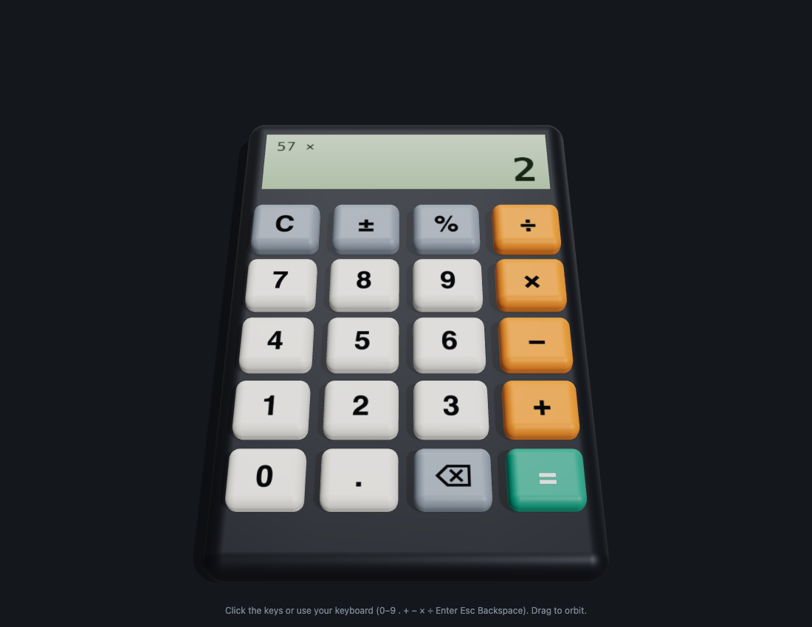

# three.js calculator

A 3D calculator built with three.js. Click the keys or type (0-9 . + - * / % Enter Esc Backspace). Drag to rotate it.

Live: https://chime-mu.github.io/threejs-calculator/

Source of truth: the `shared-sandbox` repo on Buzz (`calculator/`).

